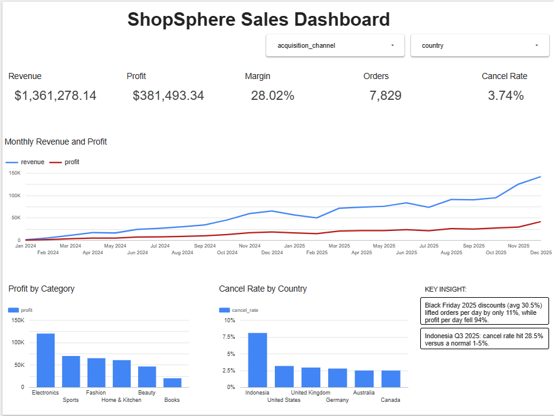
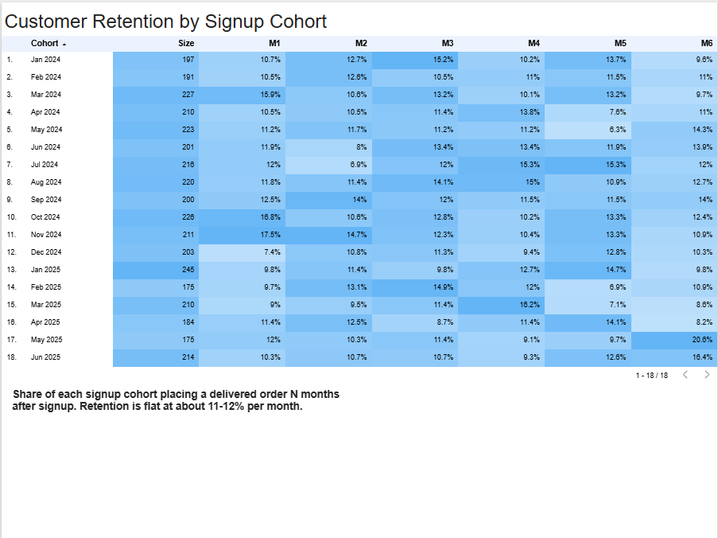

# ShopSphere E-commerce Analysis

## Objective
Analyze 2 years of e-commerce data to find what drives profit and what hurts it.

## Business Questions
1. Which product categories drive revenue and profit?
2. What caused the Q3 2025 cancellation spike in Indonesia?
3. Did Black Friday 2025 discounts increase profit?
4. Which acquisition channel brings the best customers?
5. How well are customers retained over time?

## Tools
Python (Colab), SQL (BigQuery), Looker Studio, GitHub

## Status
🚧 In progress

## Findings

### Category performance
> - **Finding:** Electronics drives the most profit ($120K, 40% of revenue) but has the lowest margin (20.3%). Beauty (45.9%) and Fashion (41.7%) are the most profitable per dollar sold.
> - **Evidence:** Delivered orders only, 2024-2025. Revenue is net of discounts.
> - **Interpretation:** Growth in Electronics adds profit but is vulnerable to discounting. High-margin categories have headroom to scale.
> - **Recommendation:** Protect Electronics margin (limit discounts), and grow Beauty and Fashion through promotion and cross-selling.

### Indonesia Q3 2025 cancellation spike
> - **Finding:** Indonesia's cancel rate hit 28.5% in Q3 2025 (82 of 288 orders), versus a normal 1-5%. It recovered to 3.2% in Q4.
> - **Evidence:** The spike hit nearly all device and payment combinations. Other countries stayed at 1-4%.
> - **Impact:** $15,948 in cancelled revenue in one quarter.
> - **Interpretation:** Consistent with a country-wide logistics or fulfillment problem, not a device or payment bug.
> - **Recommendation:** Review Q3 2025 delivery partners and delivery times in Indonesia, and set a cancel-rate alert at about 8%.

### Black Friday 2025 discounts
> - **Finding:** Black Friday week (Nov 24-30) cut profit per day by 94% versus the prior 4 weeks ($70 vs $1,157), while revenue per day fell 18%.
> - **Evidence:** Average discount rose from 5.7% to 30.5%, but orders per day grew only 11%. Margin dropped from 28.2% to 2.1%.
> - **Interpretation:** The volume lift did not cover the margin given away.
> - **Recommendation:** Cap discounts at about 15-20%, target them at high-margin categories, and test with a control group before the next sale.

### Acquisition channel quality
> - **Finding:** Referral customers are the most valuable ($82 profit per customer vs $74 for Organic) and repeat at 62.5%.
> - **Evidence:** Buyer conversion (70-72%) and repeat rate (60-63%) are similar across all 5 channels. Differences are mainly in order value (Referral and Email about $182 vs about $171).
> - **Caveat:** No acquisition cost data, so ROI can't be calculated. The gaps are small and directional.
> - **Recommendation:** Invest in the referral program, and add cost data to compare channels on ROI.

### Customer retention
> - **Finding:** About 11-12% of customers order in any given month during their first 6 months, with no decline after month 1.
> - **Evidence:** Cohort analysis of customers who signed up before July 2025 (month 0 is lower at 6.3% because signup falls mid-month).
> - **Interpretation:** Customers return steadily rather than churning early. Monthly active share is a sign of steady engagement, not total retention.
> - **Recommendation:** Track retention beyond 6 months, and test re-engagement campaigns in the months when customers are least active.

## Dashboard
🔗 [View live dashboard](https://datastudio.google.com/s/vzcjbHvQq5c)

